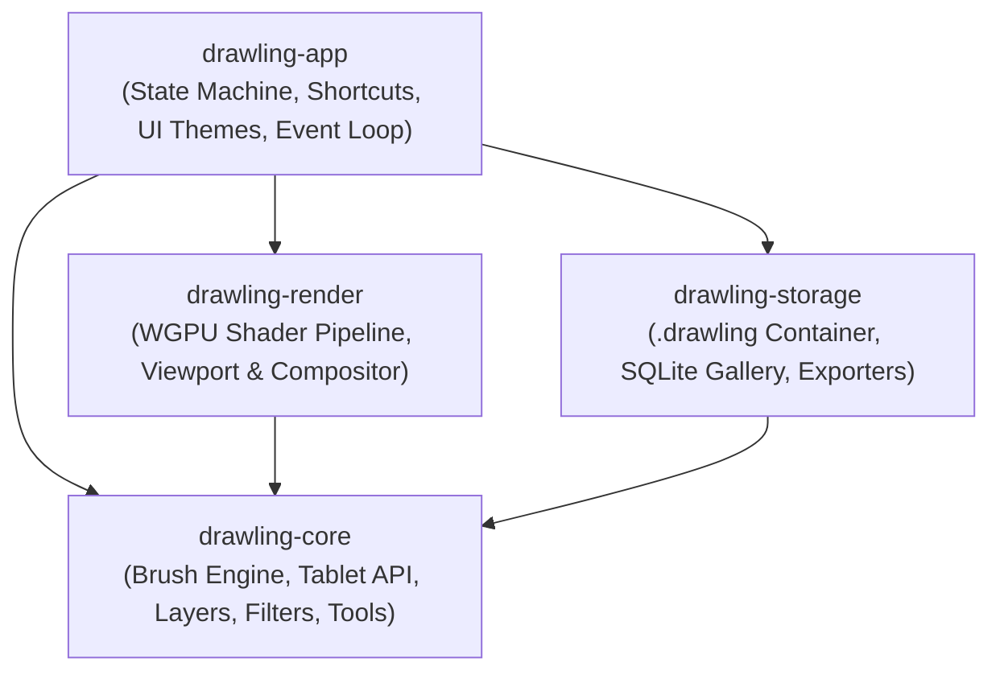

# 🦆 Drawling for Duckling

<div align="center">


%20%7C%20Windows-brightgreen)


### [⬇️ Download Windows Executable (.exe)](https://github.com/The-duckling-Group/Drawling/releases/latest)

**A Next-Generation, GPU-Accelerated Digital Drawing & Illustration Studio Built in Rust.**  
*Inspired by professional illustration powerhouses like IbisPaint and Clip Studio Paint, engineered with ultra-low latency, multi-threaded Rayon image filters, WGPU hardware acceleration, and full stylus hardware dynamics.*

</div>

---

## 📥 Download & Quickstart

| Platform | Download | Format | Description |
|:---|:---|:---|:---|
| **Windows 10 / 11 (64-bit)** | [**`drawling-windows-x86_64.zip`**](https://github.com/The-duckling-Group/Drawling/releases/latest) | Standalone `.exe` | Portable, zero installation required. Unzip and launch `drawling.exe`. |
| **Linux (x86_64)** | [**`drawling-linux-x86_64.tar.gz`**](https://github.com/The-duckling-Group/Drawling/releases/latest) | Binary | Native binary optimized for modern Linux & KDE Plasma. |

All releases, source archives, and checksums are available on the [**GitHub Releases Page**](https://github.com/The-duckling-Group/Drawling/releases).

---

## 📑 Table of Contents
1. [Download & Quickstart](#-download--quickstart)
2. [Architecture & Workspace](#-architecture--workspace)
2. [Key Features](#-key-features)
   - [High-Performance Brush Engine & Stabilization](#1-high-performance-brush-engine--stabilization)
   - [Graphics Tablet & Stylus Support (XP-Pen, Wacom, Huion)](#2-graphics-tablet--stylus-support-xp-pen-wacom-huion)
   - [Illustration Tools & Vector Shapes](#3-illustration-tools--vector-shapes)
   - [Advanced Layer System & 13 Blend Modes](#4-advanced-layer-system--13-blend-modes)
   - [Selection & Transformation Suite](#5-selection--transformation-suite)
   - [Multi-Threaded Artistic Filters & Color Adjustments](#6-multi-threaded-artistic-filters--color-adjustments)
   - [File Storage & Local Gallery](#7-file-storage--local-gallery)
   - [UI / UX Design & Theme Integration](#8-ui--ux-design--theme-integration)
3. [Keyboard Shortcuts Reference](#-keyboard-shortcuts-reference)
4. [Building and Running](#-building-and-running)
5. [License](#-license)

---

## 🏛 Architecture & Workspace

Drawling is built as a modular Rust workspace divided into 4 crates:



```
.
├── crates/
│   ├── drawling-core/       # Core math, brush engine, tablet calibration, filters, tools & layer stack
│   ├── drawling-storage/    # .drawling container (ZIP/JSON), SQLite project gallery, PNG/JPEG/SVG export
│   ├── drawling-render/     # WGPU WGSL pipeline, canvas viewport, Rayon multi-threaded compositor
│   └── drawling-app/        # Desktop application orchestration, state management, shortcuts & themes
├── Cargo.lock
├── Cargo.toml
└── README.md
```

---

## ✨ Key Features

### 1. High-Performance Brush Engine, IbisPaint Brushes & Stabilization
- **Authentic IbisPaint Brush Library**:
  - Preloaded with authentic IbisPaint presets: *Weicher Füllfederstift (Bleiche)*, *Harter Füllfederstift*, *Digitalstift*, *Filzstift (hart)*, *Filzstift (weich)*, *Airbrush (Normal)*, *Bleistift (#1)*, *Wasserfarbe (weich)*, and *G-Pen (Manga Inking)*.
  - **Start/End Tapering (Anpress-Fading)**: Sliders for Anfangsbreite (Start Width %), Endbreite (End Width %), Anfangsdeckkraft (Start Opacity %), and Enddeckkraft (End Opacity %).
- **IbisPaint Brush Importer & ABR Support**:
  - Import brushes directly via IbisPaint QR-Code payloads (base64) or JSON configurations.
  - Full Adobe Photoshop (`.abr`) brush resource parsing.
- **Stroke Stabilization (Verwackel-Korrektur)**:
  - **Echtzeit (Realtime Mode)**: Low-latency exponential filter keeping the pen directly under the mouse or XP-Pen stylus tip without trailing lag.
  - **Danach (Post-Correction)**: Moving-average curve smoothing.
  - **Lazy Mouse / Rope Mode**: Pulled-string anchor with configurable rope length and tension damping.
  - **Pixel-Perfect Alignment**: Screen-to-canvas coordinate mapping guarantees the brush tip dab center precisely follows the mouse pointer and stylus nib.
- **Sub-Pixel Stamp Engine**:
  - Continuous spacing with sub-pixel dab distribution.
  - Customizable opacity, flow, smoothstep hardness falloff, and stochastic scattering.

---

### 2. Graphics Tablet & Stylus Support (XP-Pen, Wacom, Huion)
- **8,192 Pressure Levels**: Full high-resolution digitizer input mapped through customizable curves:
  - `Linear`
  - `Soft` ($\gamma = 0.65$, sensitive for light touch)
  - `Hard` ($\gamma = 1.6$, requiring firm pressure for heavy strokes)
  - `Bezier` & `Gamma`
- **Hardware Deadzone Thresholding (1.5%)**: Eliminates unwanted resting-hand scratches.
- **3D Tilt Dynamics ($\pm 60^\circ$)**:
  - Converts raw tilt coordinates into 3D azimuth and altitude vectors.
  - **Rotated Elliptical Dabs**: Dynamically deforms the brush dab into an angled ellipse matching stylus orientation (essential for realistic pencil shading).
- **Inverted Physical Eraser Tip**:
  - Automatically activates eraser mode when flipping the pen (`TabletTool::Eraser`) without requiring toolbar switching.
- **Stylus Barrel Buttons**:
  - **Button 1**: Instantly sample colors under the stylus via eyedropper.
  - **Button 2**: Secondary shortcut trigger.
- **Preconfigured Profiles**: Out-of-the-box calibration for `xp_pen_standard()`, `xp_pen_soft()`, `xp_pen_hard()`, `wacom_pro_pen_2()`, and `huion_standard()`.

---

### 2b. Canvas Resize & Aspect Ratio Presets
- Configurable canvas resolution dialog:
  - Presets: *1:1 Quadrat (1080x1080)*, *SD (1280x720)*, *Full HD (1920x1080)*, *Story 9:16 (1080x1920)*, *Twitter Header (1500x500)*, *4K UHD (3840x2160)*.
  - Custom Width, Height, and DPI (72 to 1200 DPI).
  - Rescales buffers, layer stacks, compositor textures, and viewports on the fly.

---

### 3. Illustration Tools & Vector Shapes
- **Smudge & Color Dragging Engine**: Realistic paint pickup, wet-on-wet blending, and color bleeding across adjacent strokes.
- **Flood Fill (Bucket Tool)**:
  - 4-way BFS flood fill with Euclidean color distance tolerance.
  - **Lineart Halo Expansion (Dilation)**: Expands fill $N$ pixels beneath lineart borders to eliminate white fringing.
- **Geometric Vector Shapes**:
  - Anti-aliased straight lines with stroke thickness.
  - Outlined and filled Rectangles and Ellipses.
  - Regular Stars with customizable ray counts and inner/outer radius ratios.
- **Color Palettes**:
  - 5 artist-curated palettes: *Neon Cyberpunk*, *Anime Skin Tones*, *Manga Screentone*, *Pastel Anime*, *Classic Oil & Gouache*.
  - Automatic FIFO Recent Colors buffer and Hex import/export.

---

### 4. Advanced Layer System & 13 Blend Modes
- **13 Mathematically Exact Blend Modes**:
  `Normal`, `Multiply`, `Screen`, `Overlay`, `Darken`, `Lighten`, `Color Dodge`, `Color Burn`, `Add (Linear Dodge)`, `Subtract`, `Difference`, `Soft Light`, `Hard Light`.
- **Clipping Masks**: Clip any layer to the silhouette and alpha channel of base layers.
- **Alpha Lock**: Paint strictly within existing non-transparent pixels.
- **Layer Stack Management**: Unlimited layers, reordering, duplicate, merge down, and opacity adjustment.

---

### 5. Selection & Transformation Suite
- **Selection Tools**:
  - Rectangle and Ellipse marquee tools.
  - **Freehand Lasso**: Polygon scanline rasterization with even-odd fill rules.
  - **Magic Wand**: Flood selection with Euclidean color tolerance and anti-aliased edge feathering.
  - **Boolean Mask Logic**: Union, Subtract, Intersect, Expand, and Contract.
- **Transformations**:
  - 2D Affine Transformation matrix (Translation, Rotation, Scaling, Skew) with high-fidelity Bilinear Interpolation.
  - Mesh-Warp grid interpolation and Perspective vanishing-point guides with angle snapping.
- **Symmetry Guides**:
  - Horizontal & Vertical mirror reflection axes.
  - **$N$-Fold Radial Symmetry** (Mandala & Kaleidoscope illustration).

---

### 6. Multi-Threaded Artistic Filters & Color Adjustments
Accelerated via **Rayon** across all CPU cores:
- **Gaussian Blur**: Multi-threaded separable 1D convolution with arbitrary radius ($\sigma$).
- **Motion Blur**: Directional linear blur with configurable angle and distance.
- **Radial / Zoom Blur**: Focus-point zoom blur for dramatic action lines.
- **Unsharp Mask**: Edge-enhancing high-pass sharpening.
- **Manga Halftone (Screentone)**: Rotated dot grid pattern generator for comic shading.
- **Chromatic Aberration**: Optical lens RGB displacement.
- **Bloom / Glow**: Luminance thresholding, Gaussian blur, and additive screen blend.
- **Mosaic / Pixelate**: Block-based pixel color averaging.
- **Film Grain & Noise**: Monochromatic and RGB photographic noise texture.
- **Tone Adjustments**: Levels (Black/White/Gamma), Invert, Sepia, Hue/Saturation, Brightness/Contrast, Vignette, Gradient Map.

---

### 7. File Storage & Local Gallery
- **`.drawling` Open Container Format**:
  - Lossless compressed ZIP archive containing:
    - `project.json`: Complete project manifest, layer hierarchy, blend modes, and timestamps.
    - `thumbnail.png`: High-resolution artwork preview.
    - `layers/{layer_id}.png`: Lossless PNG buffers for each individual layer.
- **Export Formats**: PNG (lossless 32-bit), JPEG (quality-controlled with matte background composition), and SVG (scalable vector format with embedded raster data).
- **Local Gallery Database (SQLite)**:
  - Local database (`projects.db`) indexing project titles, file paths, thumbnails, tags, and editing duration.
  - Auto-save journaling for crash recovery.

---

### 8. UI / UX Design & Theme Integration
- **Modern Themes**:
  - **KDE Plasma Breeze Dark**: Native `#232629` dark surface with `#3daee9` Plasma accent.
  - **Windows 11 Dark**: Fluent slate dark theme with `#60cdff` accent.
- **Zen Mode**: Press `Tab` or `F11` to hide all UI panels for distraction-free painting.
- **Sub-Pixel Pan, Zoom & Rotation Viewport**: Smooth zooming (5% to 5000%) with anchored coordinate transforms.

---

## ⌨️ Keyboard Shortcuts Reference

| Shortcut | Action | Description |
|:---|:---|:---|
| `B` | **Brush Tool** | Standard raster/inking brush |
| `E` | **Eraser Tool** | Switch to eraser (or flip physical stylus) |
| `J` | **Smudge Tool** | Paint blending & dragging |
| `G` | **Bucket Tool** | Flood fill with expansion |
| `I` | **Eyedropper** | Color sampling (or barrel button 1) |
| `U` | **Shape Tool** | Line, Rect, Ellipse, Star |
| `L` | **Lasso Tool** | Freehand polygon selection |
| `W` | **Magic Wand** | Color-tolerance selection |
| `Ctrl + T` | **Transform** | Free transform & warp |
| `Ctrl + Z` | **Undo** | Step backward in history stack |
| `Ctrl + Y` | **Redo** | Step forward in history stack |
| `Ctrl + S` | **Save** | Save project as `.drawling` archive |
| `Ctrl + E` | **Export** | Quick export to PNG |
| `Tab` / `F11` | **Zen Mode** | Toggle distraction-free full canvas mode |
| `Ctrl + I` | **Invert Filter** | Invert active layer colors |
| `Ctrl + L` | **Levels Filter** | Open Levels & Curves tone adjustment |
| `Ctrl + U` | **Hue / Saturation** | Adjust hue, saturation, and lightness |
| `Ctrl + Alt + B`| **Gaussian Blur** | Apply multi-threaded Gaussian blur |
| `Ctrl + Alt + M`| **Motion Blur** | Apply directional motion blur |

---

## 🚀 Building and Running

### Prerequisites
- [Rust](https://www.rust-lang.org/) (2021 Edition, MSRV 1.75+)
- Modern GPU supporting Vulkan, DirectX 12, or Metal (for `wgpu`)

### Run All Unit & Integration Tests
```bash
cargo test --workspace
```

### Run System Benchmark & Verification Suite
```bash
cargo run --release -p drawling-app -- --demo
```

### Run Interactive Application
```bash
cargo run --release -p drawling-app
```

---

## 📄 License
Licensed under either of:
- **MIT License** ([LICENSE-MIT](LICENSE-MIT))
- **Apache License, Version 2.0** ([LICENSE-APACHE](LICENSE-APACHE))

at your option.
